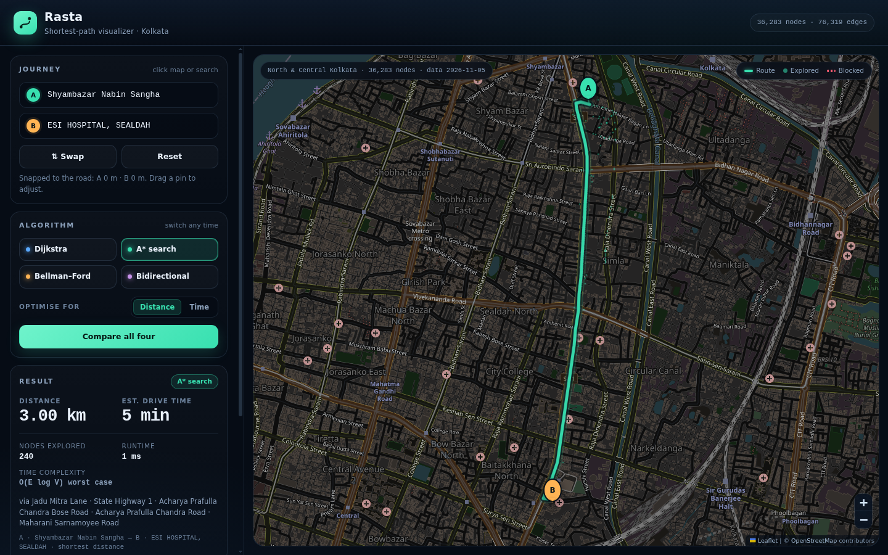

# Rasta — Shortest Path Visualizer

An interactive route-finding demo built on **real OpenStreetMap road data** for
north, central and east Kolkata. Pick any two points on the map, then watch and
compare four shortest-path algorithms running in your browser.

Everything the routing needs is local: the road graph (`data/graph.json`) and
Leaflet are bundled in this repository, so the demo still works when the seminar
hall has no Wi-Fi. Map tiles are the only online extra.



## Quick start

```bash
cd Rasta
python3 -m http.server 8000
# open http://localhost:8000
```

Any static file server works. Opening `index.html` directly from disk will not,
because the browser blocks `fetch()` of the graph file over `file://`.

## What it does

- **Click anywhere** on the map: first click sets **A**, second sets **B**.
  Clicks snap to the nearest road node, and a dashed line shows the short walk
  from your click to the snapped node. Drag either pin to move it.
- **Search places**: the search boxes know 273 offline landmarks (stations,
  hospitals, colleges, parks, malls…) and snap them to the road network.
- **Switch algorithms at any time**: Dijkstra, A*, Bellman–Ford, Bidirectional
  Dijkstra. The current start and destination are re-used, so the numbers are
  directly comparable.
- **Compare all four** in one table: distance, estimated drive time, nodes
  explored, runtime in this browser, and theoretical complexity.
- **Optimise for distance or time**. Time mode uses each road's `maxspeed` tag
  (with sane defaults per road class) rather than distance.
- **Block a road**: click the highlighted route to close that segment and the
  search reruns around it. Blocks stay until you clear them.
- **Animate the search**: explored nodes are painted in the order the algorithm
  settles them.

## The four algorithms

All four are hand-written in [`js/algorithms.js`](js/algorithms.js) — no routing
library, because the algorithms are the point of the project. The graph uses
compressed sparse rows over typed arrays, and Dijkstra/A*/Bidirectional share a
binary min-heap.

| Algorithm | Idea | Time complexity | Notes |
| --- | --- | --- | --- |
| Dijkstra | Grow a frontier by smallest known cost | `O((V + E) log V)` | Baseline; settles every node closer than the target |
| A* | Dijkstra + straight-line distance heuristic | `O(E log V)` worst case | Same optimal route, usually far fewer nodes explored |
| Bellman–Ford | Relax every edge `V − 1` times | `O(V · E)` | Handles negative weights in general; here it also demonstrates why it is slow. It computes all shortest paths from the source, so its "explored" count is every reachable node |
| Bidirectional Dijkstra | Search forward from A and backward from B until the frontiers meet | `O((V + E) log V)` | Two smaller searches; stops earlier than one big one |

A*'s heuristic is straight-line distance, divided by the fastest speed in the
graph in time mode, which keeps it admissible so A* returns the same optimal
route as Dijkstra.

### Why Bidirectional Dijkstra as the fourth?

Floyd–Warshall was the other candidate in the plan. It computes *all-pairs*
shortest paths and needs a `V × V` distance matrix — for this graph that is
around 9 billion entries before any other overhead, which is not viable in a
browser. Bidirectional Dijkstra keeps the same optimal result and is a fair
fourth comparison, so the project uses it and the comparison table stays
meaningful. (Floyd–Warshall would make sense on a small hand-made grid; that is
a different demo.)

## Data

- **Area:** `22.555, 88.355 → 22.635, 88.495` (south, west, north, east) —
  Shyambazar, Bagbazar, Cossipore, Belgachia, Dum Dum, Ultadanga, Kankurgachi,
  Sealdah, Rajabazar, Salt Lake, New Town and Rajarhat.
- **Source:** OpenStreetMap via the Overpass API, downloaded on 2026-11-07.
  Tiles: `tile.openstreetmap.org` with attribution.
- **Size:** 95,280 nodes, 195,433 directed edges, 947 named roads, 6.7 MB JSON.
- **Licence:** © OpenStreetMap contributors, [ODbL](https://www.openstreetmap.org/copyright).
- The graph is reduced to its largest weakly connected component, so any two
  snapped clicks can be routed. One-way streets, roundabouts and turn
  restrictions encoded as one-ways are respected; turn *penalties* are not.
- Speeds come from `maxspeed` where present, otherwise from per-class defaults
  (residential 30 km/h, secondary 50, primary 60, and so on).

To rebuild or change the area:

```bash
python3 tools/fetch_roads.py                          # default area
python3 tools/fetch_roads.py --bbox 22.55,88.34,22.60,88.40
```

Downloads are cached per tile under `data/raw/`, so an interrupted run resumes.
The script also fetches named places for offline search.

## Offline behaviour

- Leaflet 1.9.4 and its marker images are in `vendor/leaflet/`.
- The road graph, place list and all algorithm code are local.
- Tiles come from the OpenStreetMap tile server and are dark-styled with a CSS
  filter. If tiles cannot be fetched, the app keeps working: the main road
  network is drawn from the graph itself, and a small note explains that tiles
  are unavailable.

## Using it in a demo

1. Load the page; a sample route (Shyambazar → Sealdah) is already drawn.
2. Switch between algorithms to show the explored-node animation and the
   explored/runtime differences.
3. Press **Compare all four** for the side-by-side table.
4. Toggle **Optimise for → Time** and show that the route can change, because
   the fastest road is not always the shortest.
5. Click the route to block a road and show the reroute
   ([blocked-road screenshot](docs/blocked-demo.png)).
6. Search "Sealdah" or "Belgachia" to demonstrate offline place search.

## Project structure

```
index.html              UI shell
css/style.css           interface styling
js/algorithms.js        road graph + Dijkstra, A*, Bellman–Ford, bidirectional Dijkstra
js/canvas-layer.js      canvas overlay for the explored-node animation
js/app.js               map, snapping, routing UI, comparison table, road blocks
data/graph.json         pre-downloaded road graph + offline place list
data/raw/               cached Overpass responses (used by the fetch script)
tools/fetch_roads.py    Overpass download → graph conversion
tools/test_algorithms.js  Node harness: cross-checks all four algorithms
vendor/leaflet/         Leaflet 1.9.4 (offline copy)
```

## Verifying the algorithms

```bash
node tools/test_algorithms.js
```

The harness builds the graph, runs all four algorithms over random node pairs,
and checks that:

- every algorithm returns the same total weight (they are all optimal),
- every path is a real chain of existing edges from source to target,
- reported distance/duration equal the sum over the path edges.

It also prints runtimes and explored counts so the comparison table can be
sanity-checked.

### Route sanity check

The default demo route (Shyambazar Nabin Sangha → ESI Hospital, Sealdah) comes
out at **3.00 km**. On the same snapped endpoints the public OSRM router
reports 3.28 km, while the straight-line distance between them is 2.84 km. The
small gap is expected: OSRM snaps to a different carriageway and applies turn
restrictions that this project does not model. Drive times are free-flow, so
they are optimistic compared with live-traffic estimates.

## Known limitations

- Static travel times only — no live traffic, signals, or time-of-day effects.
- The short walk from a click to the snapped road node is shown but not added
  to the route totals, so all algorithms are compared on the same road network.
- Coverage is the downloaded bounding box above; clicks outside it snap to the
  nearest edge node, and the dashed connector shows the remaining walk.
- No turn restrictions or turn penalties; one-way tags are honoured.
- Tile labels and context need internet; routing does not.
